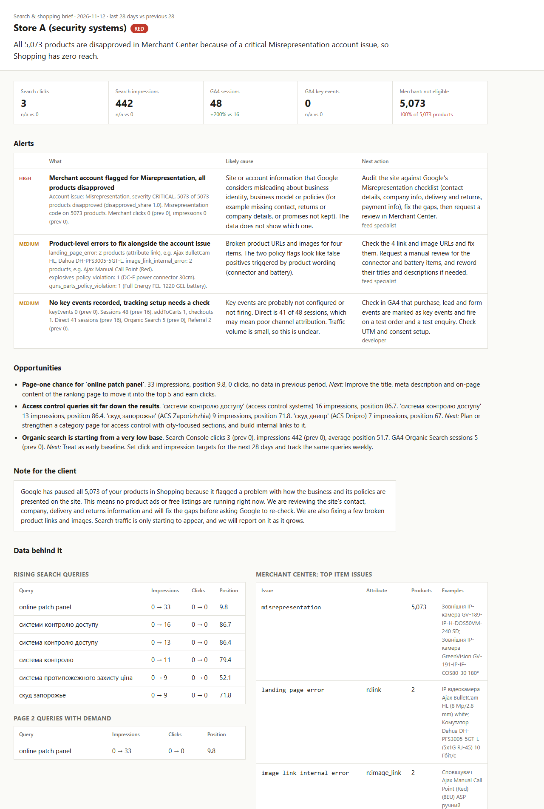
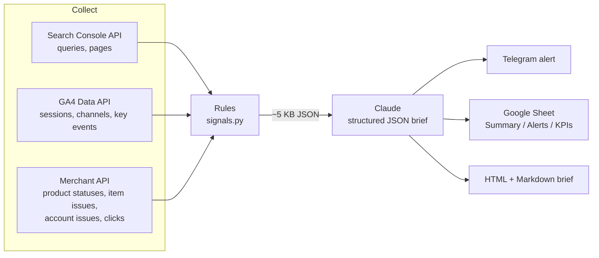
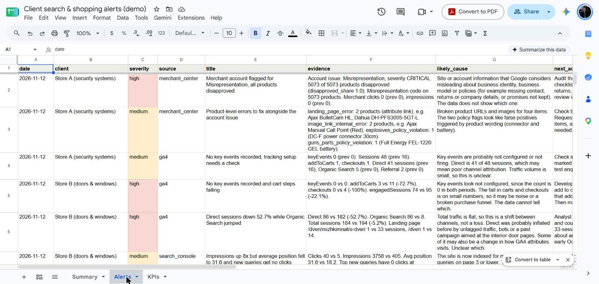
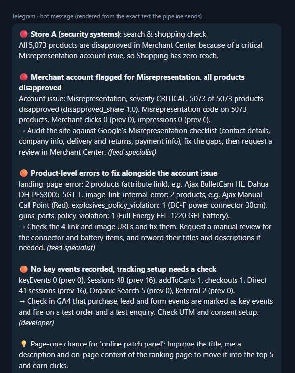

# Search & Shopping alerts with Claude

Pulls Google Search Console, GA4 and Merchant Center data for every client, flags what changed with plain rules, asks Claude to explain it, and sends the account team a short alert in Telegram plus a row-per-alert log in Google Sheets.

I built it as a working sample for one item in an AI Operations job description: *"Connect Google Search Console, GA4 and Merchant Center to Claude, so our client account team gets analysis and alerts automatically."*

It runs on live data from four small Ukrainian e-commerce stores I manage. In this repo they appear as Store A to D: names and domains are masked, and revenue is never collected.



## What one run produced (12 Nov 2026, 28 days vs previous 28)

| Store | Status | Headline from Claude |
|---|---|---|
| A, security systems | red | All 5,073 products are disapproved in Merchant Center because of a critical Misrepresentation account issue, so Shopping has zero reach. |
| B, doors & windows | amber | Organic search is growing fast (40 clicks vs 5), but GA4 shows no key events and Direct traffic halved, so tracking needs checking first. |
| C, backup power | amber | Search visibility started this period (1,138 impressions, 18 clicks from zero), but GA4 shows 0 key events despite 2 checkouts. |
| D, exoskeletons | amber | All 14 products are still pending first review in Merchant Center, so no Shopping traffic yet; the store is new and traffic is tiny. |

Full outputs for each store are in [`sample/`](sample/): the compact signals Claude received, its structured answer, and the HTML and Markdown briefs.

Store A's Merchant account really is suspended for Misrepresentation. Two days before this run I audited that site by hand and found the cause: the theme promised cashback and same-day dispatch that the store does not offer. Claude's brief points at the same kind of mismatch and lists the checks a feed specialist would run.

Run numbers: 4 clients in 1 min 46 s, Claude (Sonnet) took 10 to 21 s and $0.03 to $0.06 per client.

## How it works



1. **Collect** (`opsbrief/sources.py`). One Google service account with read access to all three products. Current period vs the previous period of the same length. Search Console is shifted 3 days back because its data lags.
2. **Rules** (`opsbrief/signals.py`). Week-over-week (or month-over-month) drops, disapproval share, account-level issues, rising and new queries, and page-2 queries that already get impressions. Thresholds are per client. Every alert can be traced to a line of code, and small bases are ignored so a drop from 4 clicks to 2 does not page anyone.
3. **Claude** (`opsbrief/analyst.py`). Gets the compact signals, not raw API dumps, and must answer in a fixed JSON schema: status, headline, up to 5 alerts (evidence, likely cause, next action, owner), opportunities, and a short note the account manager can paste to the client. The prompt forbids numbers that are not in the input and asks it to read across sources: for example, Search Console clicks up while GA4 records zero key events means tracking, not SEO.
4. **Deliver** (`opsbrief/deliver.py`). Telegram message with the top 3 alerts, rows appended to a Google Sheet (tabs are created on first run), and an HTML brief per client.

Claude runs in one of two ways, with the same prompt and schema:
- `ANTHROPIC_API_KEY` set: Anthropic Messages API with a forced tool call, for a server or an n8n Execute Command node.
- No key: the local Claude Code CLI in headless mode (`claude -p --json-schema ...`) with tools, MCP servers and project settings switched off, so each call costs a few cents instead of loading a whole agent context.





## Run it

```bash
pip install -r requirements.txt
cp .env.example .env                      # service account path, Telegram, sheet id
cp clients.example.json clients.json      # one entry per client
python -m opsbrief.run --dry-run          # collect + analyze, write out/, send nothing
python -m opsbrief.run                    # also Telegram + Google Sheet
python -m opsbrief.run --client store-a --from-cache   # re-run only the analysis
python -m opsbrief.run --public           # mask client names and domains everywhere
python -m pytest -q                       # rule tests, no network
```

Google setup, once per client:
- Search Console: add the service account email as a user (Restricted is enough).
- GA4: add it as Viewer on the property.
- Merchant Center: add it under Access and services (Standard + Performance). Merchant API also needs the Google Cloud project registered with each account (`developerRegistration:registerGcp`); that call needs Admin rights, so grant Admin, call it once, then drop the role back. I did exactly that here and the account now reads with Standard only.
- Google Sheet: share it with the service account as Editor.

Schedule it with cron, Windows Task Scheduler, or an n8n Schedule trigger that runs the command and posts the result to Slack or ClickUp instead of Telegram.

## What I would add for an agency

- Client list from HubSpot companies instead of a JSON file, and alerts written back as HubSpot tasks or ClickUp tasks for the account owner.
- A "known issue" memory per client, so a suspension that is already being handled is reported as a status line, not a fresh red alert every week.
- Looker Studio on top of the KPIs tab for trends; the brief stays the human-readable layer.
- Merchant price competitiveness and best-seller reports (also in the Merchant API) for stores that run Shopping ads.

## Limits

- These stores are small and young, so many changes sit on small numbers. The rules ignore tiny bases, and Claude is told to call noise noise, but a bigger client would need tuned thresholds.
- Claude's "likely cause" is a hypothesis for a person to check, labelled as such in every alert. It does not change anything in the accounts.
- Revenue is not collected on purpose. Adding it is one metric in `sources.ga4`.

## Files

```
opsbrief/sources.py    GSC, GA4, Merchant API collectors
opsbrief/signals.py    rules and thresholds
opsbrief/analyst.py    Claude prompt, JSON schema, API or CLI backend
opsbrief/deliver.py    Telegram, Google Sheets, HTML/Markdown
opsbrief/run.py        CLI: one run per client, masking, cache
tests/                 rule tests
sample/                anonymized outputs from the 12 Nov run
```

Author: Ihor Verzin
